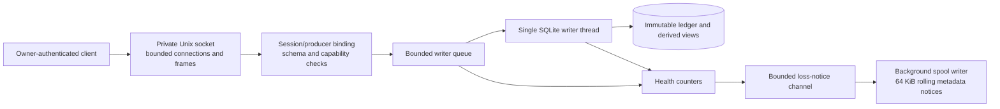

# Local observer daemon — M1 O01

Mertis now has a Linux-only authenticated local daemon for synthetic metadata. This implements the IPC/writer slice of M1, not live-agent monitoring or the whole M1 milestone. It opens no TCP/HTTP listener, starts no agents, changes no global configuration, and makes no model calls.

Build and run in one terminal:

```sh
cargo build --workspace --locked
cargo run --locked -p mertis -- --home /tmp/mertis-daemon-demo daemon start
```

`start` runs in the foreground. In another terminal, inspect health, send the checked-in cached fixture through a Rust IPC client, and stop:

```sh
cargo run --locked -p mertis -- --home /tmp/mertis-daemon-demo daemon status
cargo run --locked -p cs-daemon --example cached_session -- /tmp/mertis-daemon-demo
cargo run --locked -p mertis -- --home /tmp/mertis-daemon-demo daemon stop
```

The example reports 150 input tokens after the cumulative revision; repeating it deduplicates source events. The original offline `import`/`inspect` commands remain available. SQLite serializes competing standalone writers; an offline write racing the daemon can return a bounded lock error. They are explicit separate processes, not an automatically redirected live session path.



## Authentication and runtime files

The selected home, runtime and spool directories must be owner-owned directories with mode 0700. The private socket, lock, token and loss file use mode 0600. Linux kernel peer credentials must match the effective UID; hello must also prove possession of a 256-bit OS-random owner token. The token is read from `runtime/daemon.token` by the Rust client and is never printed. This is an owner-local trust boundary, not protection against a compromised process running as that same owner.

A held OS file lock prevents competing starts. Symlink or unsafe stale endpoints are refused. Clean shutdown removes socket/token files. SIGINT/SIGTERM request graceful shutdown. A crash may leave stale endpoints; a later explicit start verifies ownership, obtains the released lock, replaces stale endpoints and rotates the token. There is no automatic agent restart. No service is installed. The lock file may remain after shutdown; its existence does not mean a lock is held.

## Wire contract v1

Requests use a 4-byte unsigned big-endian length followed by JSON, with an 8 MiB maximum. The shape is `{"request_id":"…","operation":{"op":"…",…}}`. Unknown fields/operations are rejected. Every response contains `request_id`, `ok`, and exactly one `result` or `error`. Errors have safe code/message, `retryable: false`, and `original_must_be_preserved: true`.

Hello supplies protocol version 1, client version, producer ID/epoch, optional session binding, owner token and requested capability strings. The response grants only implemented capabilities and reports frame/batch/deadline limits. Unknown protocol versions are rejected. Operations before hello are rejected; the binding cannot be changed on that connection.

| Operation | Behavior |
|---|---|
| `hello` | Authenticate and negotiate supported capabilities |
| `event.append` | Validate and atomically append one bound synthetic event |
| `event.append_batch` | Validate all bound events, then commit one transaction |
| `session.snapshot` | Report only the connection's bound session |
| `health` | Report protocol/mode and rejection/failure/expiry/spool counters |
| `shutdown` | Request graceful stop and drain accepted writer work |

Append session, producer and epoch must all match hello. A mismatched or invalid batch commits no prefix. Event IDs/producer sequence deduplicate using the existing ledger contract. Unbound administrative connections cannot append or request session snapshots. The same owner can explicitly authenticate a new connection for another session; this is not a multi-user authorization service.

Artifact upload/retrieval, transformations, subscriptions and live adapter negotiation remain unsupported and are never granted as capabilities. These operations return a safe invalid-request/capability error rather than emulated success.

## Bounds and timeout semantics

Defaults are 16 simultaneous connections, 64 queued writer jobs, 128 events per batch and two seconds per frame/dispatch/write stage. Test/library configurations can reduce those bounds; invalid or excessive limits are rejected. The receiver checks the length before allocation and applies one absolute deadline across header/body reads, so slow sends cannot extend it indefinitely. At connection capacity, new connections close without being admitted; health counts the rejection.

The single writer owns SQLite work outside socket workers. It takes the write reservation before reading identities and limits SQLite lock waits to at most 250 ms (or the configured smaller deadline). Queued work that expires is discarded without starting a transaction. The writer counts each expired job once. An already executing transaction can finish after its caller times out; there is no claim of hard cancellation or rollback of an acknowledged side effect. A timeout means the result is unknown. Clients never retry automatically; inspect state or explicitly reimport the same source identities to reconcile.

Queue rejection, storage failure and timeout update health/loss notices. Notices contain only static reason codes and aggregate counters, never event bodies, credentials or identifiers. Spool admission is bounded and nonblocking; slow/full disks cannot hold rejection responses hostage. The spool worker rotates its file at 64 KiB. Its own 64-notice queue overflow and I/O failures increment `spool_failures`. Notices are diagnostics, not retained events or an automatic replay service; preserve the producer's originals after any rejected/unacknowledged append.

Shutdown stops accepting new clients and waits for current frame budgets and accepted writer work. Queued expired work is discarded; already executing SQLite/filesystem work can still determine completion time. Loss-notice draining has a separate configured deadline: a stalled sink is detached and shutdown reports failure rather than blocking on it forever. Health counters reset on process restart; the bounded loss file remains on disk. No latency, throughput or RSS targets have been benchmarked.

## Verification

Real-socket tests cover hello/credential/version rejection, capability grants, session/producer/epoch isolation, batch/schema/accounting rollback, dedup/restart, file modes/symlinks/singleton cleanup, frame limits, absolute slow-send deadlines, connection/queue admission, and SQLite lock contention. Writer tests reproduce and fix stalled loss reporting and duplicate expiry counts, and cover spool capacity/rotation/I/O failure. CLI tests exercise start/status/stop, SIGTERM cleanup and explicit restart after a forced process death.

Run `cargo test --workspace --locked`. Unix-socket creation is blocked by this session's sandbox, so its real IPC tests require an execution environment that permits local sockets. Linux x86_64 is the tested daemon platform; other platforms retain offline CLI support and explicitly refuse daemon operation.
