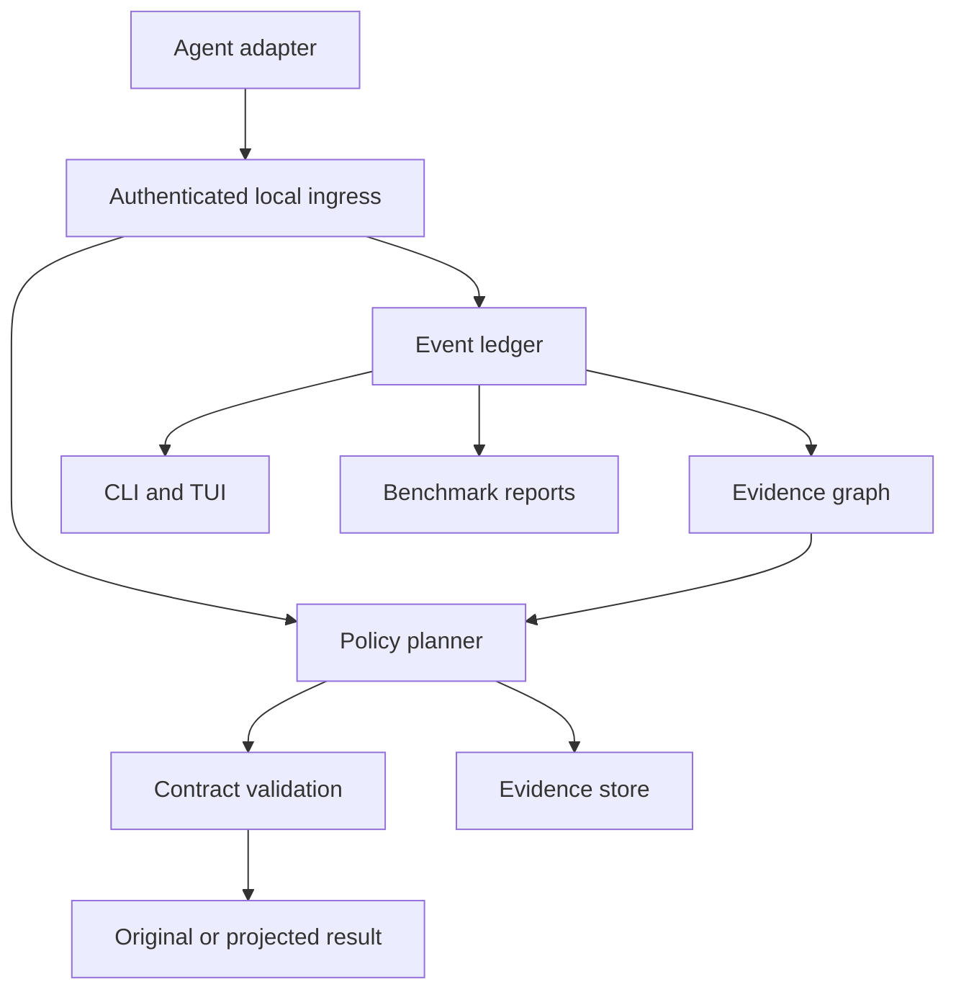

# Mertis: Rust implementation specification

Version: 1.0.0 | Date: 2026-11-05 | Status: implementation contract

This document specifies a new product. Commands, crate names, protocols, thresholds, and algorithms below are proposed interfaces, not claims that an implementation already exists. Mertis is a working name; package and trademark availability have not been checked.

## 0. Coding-agent handoff

Build Mertis as a local-first Rust application and embeddable Rust library for observing, explaining, and optimizing coding-agent context. Implement the production vertical slices in dependency order. Treat this document as the requirements baseline. Record decisions and deviations in architecture decision records (ADRs).

Start with a working observer, then add deterministic, reversible tool-output transformations, then evidence-aware planning and controlled experiments. Do not ship a dashboard backed by fabricated telemetry. Do not claim savings from an output-size comparison alone. Do not attempt hidden chain-of-thought extraction.

The first milestone must run without a model API key against checked-in synthetic fixtures. Live agent integration and paid experiments are separate capabilities. A missing live credential must not prevent implementing and validating the core.

Implementation instructions:

1. Inspect the repository and preserve existing work. If starting empty, initialize the Cargo workspace described below.
2. Create `docs/status.md`, `docs/compatibility.md`, `docs/decisions/`, and `docs/benchmarks.md`.
3. Record the installed Rust toolchain and agent versions. Select and pin a supported stable toolchain; do not assume version numbers in this document are current.
4. Implement milestones M0 through M8 in order. Within each milestone, finish an end-to-end slice before adding adjacent features.
5. For every completed requirement, link the code, meaningful tests, fixture, and demonstration command in `docs/status.md`.
6. Label unsupported adapters and unavailable measurements explicitly. Never silently emulate an upstream capability.
7. Execute relevant checks after changes. Final delivery includes reproducible build instructions, test results, benchmark limitations, and known unsupported combinations.
8. Do not install global agent configuration, start paid model calls, publish packages, or deploy remote infrastructure as a side effect of tests. Provide explicit commands for those actions.
9. Production code, benchmark orchestration, CLI, daemon, TUI, transformations, and inference policy must be Rust. Configuration, SQL, documentation, and fixture data are allowed. Prefer a Rust WASM graph viewer for the later browser UI; do not introduce a Node or Python runtime dependency.

### Product principle

Optimize the cost and token consumption of correct task completion, not the appearance of a compression ratio.

### Claim boundary

The proposed research contribution is the combination of versioned evidence, unresolved task requirements, cache-aware representation selection, and outcome-validated interventions. Novelty and superiority are hypotheses. Existing context gateways, retrieval stores, repository maps, and usage trackers are prior art.

## 1. Outcomes, scope, and release levels

### Required user outcomes

- Install one native binary and inspect coding-agent sessions from a terminal.
- See model calls, tool calls, timing, reported token usage, estimated costs, and visibility gaps per session and task.
- Inspect why each observation remains in context, when known, and how its representation changed.
- Enable a conservative optimization policy for one explicitly selected session.
- Recover exact original evidence when a projection omitted useful detail.
- Compare policies with full-task evaluations, including failures, retries, retrieval, and optimizer overhead.
- Reuse the policy engine as a Rust library inside a custom agent harness.
- See an execution/evidence map with observed, agent-reported, and inferred relationships clearly distinguished.

### Release levels

| Level | Name | Contract |
|---|---|---|
| R0 | Observe | No modification of any agent input or tool output |
| R1 | Conservative | Recognized structured output projections; durable originals; verified recovery path |
| R2 | Evidence | Versioned source excerpts, requirement links, cache-aware planning |
| R3 | Experimental | Learned policies, checkpoint interventions, semantic compaction, advanced gateway controls |

R3 features are disabled by default and cannot graduate solely because a local benchmark shows smaller payloads. Observe is the default everywhere.

### Non-goals for R0/R1

- Universal integration with every agent or subscription authentication scheme.
- Replacing the coding agent, its permissions, its sandbox, or its planning loop.
- Model routing, automatic model downgrades, or changing reasoning effort.
- Revealing private internal reasoning or claiming to measure attention.
- Hosted accounts, team billing, remote code upload, vector databases, or automatic cross-session memory injection.
- Automatic replay of side-effecting tool calls from historical transcripts.

### Platform order

Tier 1: Linux x86_64/aarch64, macOS arm64, WSL2 Linux. Tier 2: native Windows x86_64 and macOS x86_64 after process/terminal parity tests. CLI import/report functionality must remain portable even when launch integration is unsupported. Do not advertise native Windows launcher support until signal, console, path, named-pipe, and configuration tests pass.

## 2. Architecture and runtime modes

### Processes

`mertis` is one binary with CLI subcommands. `mertis daemon` runs the same binary as a user-local service. `mertis hook` is a short-lived bridge invoked by supported agent hooks. `mertis mcp serve` is an optional stdio retrieval server. `mertis tui` is an observer in a separate terminal. The agent retains ownership of its terminal.

The daemon owns the event ledger, artifact store, and policy state. Each agent session has a separate execution identity and policy snapshot. Multiple sessions share the daemon without sharing context or retrieval authorization.

### Data path



### Modes

| Mode | Reads telemetry | Changes delivered content | Claims allowed |
|---|---|---|---|
| `observe` | Yes | No | Recorded usage and estimated diagnostics |
| `shadow` | Yes | No | Candidate size reduction, not realized session savings |
| `conservative` | Yes | Validated R1 projections | Actual delivered sizes; session effects only with comparisons |
| `experimental` | Yes | Explicitly selected R2/R3 features | Same evidence rules, with experiment labels |

Separate two control planes: the performance optimizer may fail open by forwarding the original unchanged; privacy and authorization checks fail closed for storage/export/retrieval. Never bypass a provider authentication failure or agent permission decision to keep optimization working.

## 3. Cargo workspace and dependency boundaries

| Crate | Ownership | Allowed internal dependencies |
|---|---|---|
| `cs-core` | IDs, events, capability types, policy contracts, errors | None |
| `cs-store` | SQLite, artifacts, migrations, leases, retention | core |
| `cs-accounting` | Usage normalization, token estimates, pricing, attribution | core |
| `cs-projectors` | Deterministic parsers and representation builders | core |
| `cs-evidence` | Versions, symbols, requirements, graph queries | core, store |
| `cs-policy` | Candidate scoring, gates, certificates, budget selection | core, accounting, projectors |
| `cs-adapters` | Claude, Codex, fixture, SDK event translation | core |
| `cs-daemon` | IPC, scheduling, sessions, transactions | all preceding crates |
| `cs-mcp` | Session-scoped retrieval/search tools | core, store |
| `cs-gateway` | Optional explicit API gateway | core, accounting, policy |
| `cs-bench` | Task runner, isolation interface, statistics | core, store, accounting |
| `cs-ui` | Ratatui views and export rendering | core, accounting |
| `mertis` | Clap commands and composition root | selected crates |
| `mertis-sdk` | Stable public library facade | core, policy, accounting |

The planner accepts an immutable evidence snapshot through a trait. It must not directly open the database or execute tools. `cs-projectors` performs no network calls and has no global mutable state. Adapters cannot alter permissions. UI code cannot execute recorded commands.

Start with empty crates only when needed for a milestone; avoid spending the first milestone generating an unused architecture.

Suggested dependencies, subject to compatibility and license review at implementation time:

- Async/process/network: `tokio`, `tokio-util`, `bytes`, `axum` for optional HTTP ingress, `reqwest` and `rustls` for the optional gateway.
- Serialization/config: `serde`, `serde_json`, `toml`, `schemars`, `clap`.
- Storage: `rusqlite` with pinned bundled SQLite, `blake3`, `zstd`, `tempfile`.
- Terminal: `ratatui`, `crossterm`; a PTY library only for the later explicit PTY mode.
- Code structure: `tree-sitter`, pinned language grammars, `ignore`, `notify` with reconciliation scans.
- Diagnostics: `tracing`, `thiserror`; `anyhow` only at application boundaries.
- Testing: `proptest`, `insta` for justified snapshots, `criterion`, `cargo-fuzz`, subprocess integration tests.

Commit `Cargo.lock` and `rust-toolchain.toml`. Pin and document the minimum supported Rust version after resolving dependencies. Forbid unsafe code in first-party business logic; narrowly scoped platform integration exceptions require an ADR and tests. Do not expose a native Rust ABI plugin system. Later plugins use bounded subprocess IPC or restricted WASM.

## 4. Domain model and event semantics

### Identity hierarchy

`repository -> worktree -> session -> task -> turn -> model request/tool call`.

Repository identity includes canonical root identity and a local random ID, not merely the remote URL. Worktree identity distinguishes concurrent checkouts. Session ID is generated by Mertis and mapped to the upstream agent ID. A resumed upstream conversation can reuse the logical session but starts a new process epoch. Forked conversations create separate lineage branches. A task may span several turns; do not equate a shell process or user prompt with successful task completion.

Use opaque IDs serialized as strings. Use UTC wall-clock timestamps for display/correlation and monotonic per-process elapsed time for durations. Store collector sequence numbers and producer epoch/sequence separately. Cross-process ordering is partial; missing producer sequence is represented as unknown.

### Event envelope

The Rust implementation must expose equivalent typed structures. This is a wire-contract sketch; final code must provide every referenced type and schema.

```rust
pub struct EventEnvelope {
    pub schema_version: u16,
    pub event_id: EventId,
    pub session_id: SessionId,
    pub producer_id: ProducerId,
    pub producer_epoch: String,
    pub producer_sequence: Option<u64>,
    pub observed_at_unix_ms: i64,
    pub source_timestamp_unix_ms: Option<i64>,
    pub task_id: Option<TaskId>,
    pub turn_id: Option<TurnId>,
    pub correlation_id: Option<String>,
    pub visibility: Visibility,
    pub payload: EventPayload,
}

pub enum Measurement<T> {
    Reported { value: T, source: String },
    Estimated { value: T, method: String, version: String },
    Unavailable { reason: String },
}

pub enum EvidenceKind { Observed, AgentReported, Inferred }
```

Event payloads must cover:

| Family | Variants |
|---|---|
| Lifecycle | SessionStarted, SessionResumed, SessionEnded, TaskStarted, TaskOutcomeRecorded |
| Model | RequestStarted, RequestCompleted, RequestFailed, UsageObserved, ModelChanged |
| Tools | ToolStarted, ToolCompleted, ToolFailed, ToolCancelled |
| Evidence | ArtifactStored, FileVersionObserved, ArtifactSuperseded, RequirementRecorded |
| Context | CompactionObserved, ContextSnapshotObserved, RepresentationProposed, RepresentationCommitted, RepresentationRejected |
| Recovery | RetrievalRequested, RetrievalCompleted, RetrievalUnavailable |
| Integrity | VisibilityGap, AdapterCapabilityChanged, QueueOverflow, ReconciliationResult |
| Policy | PolicyActivated, PolicyDisabled, ExperimentAssignment |

Store unknown upstream fields in a bounded, privacy-filtered extension field. Unknown event kinds can be retained as opaque metadata but never interpreted as optimization authorization.

### Idempotency and lifecycle

Ingestion is at-least-once. Deduplicate by upstream event ID when available, otherwise by producer/epoch/sequence. Never deduplicate two independent calls merely because their contents are identical. A separate content hash may deduplicate artifact bytes.

Request state: `started -> streaming -> completed | failed | cancelled | incomplete`. Tool state is analogous. A missing completion is `incomplete`, not success. Accept late events and reconcile materialized views. End-of-stream does not necessarily mean successful completion. Streaming usage deltas and cumulative snapshots require separate normalization rules.

Imported and live events referencing the same provider request must reconcile into one accounted request. Preserve both source records and the resolution reason. When request identity cannot be reconciled, expose ambiguity rather than double-count confidently.

## 5. Persistence and artifacts

### Storage layout

Use OS-appropriate application data/config/cache directories. Support `MERTIS_HOME` for tests and portable use. Store no files inside a user's repository unless explicitly exporting a report or installing project-scoped configuration.

- `config.toml`: user settings.
- `ledger.sqlite3`: normalized ledger and materialized views.
- `artifacts/<namespace>/<hash-prefix>/<hash>`: immutable original bytes and projections.
- `spool/<producer>/<epoch>/`: bounded crash-recovery events.
- `runtime/`: local socket, lock, ephemeral authentication material.
- `reports/`: explicitly requested exports.

Use SQLite WAL with one dedicated writer actor and independent read connections. Run blocking SQLite and hashing work outside Tokio worker threads. Use bounded write batches. Enable foreign keys. Schema migrations are numbered, transactional where possible, and checksummed. Refuse to write a database created by a newer unsupported schema. Back up metadata before destructive migrations.

### Minimum schema contract

Implement SQL migrations covering these tables and constraints. JSON columns must be validated against versioned schemas at the application boundary.

| Table | Required fields and constraints |
|---|---|
| repositories | id PK, root_identity, canonical_path_encoding, created_at |
| worktrees | id PK, repository_id FK, root_identity, initial_head nullable |
| sessions | id PK, worktree_id FK nullable, agent, agent_version, upstream_session_id nullable, lineage_parent_id nullable, mode, capture_mode, policy_hash, started_at, ended_at nullable, status |
| tasks | id PK, session_id FK, prompt_ref nullable, outcome, oracle_version nullable, started_at, ended_at nullable |
| events | event_id PK, collector_seq UNIQUE, session_id FK, producer_id, epoch, source_seq nullable, kind, timestamps, payload_json, visibility; unique producer/epoch/source_seq when non-null |
| requests | id PK, session_id FK, task_id nullable, upstream_id nullable, provider, model, status, start/end, raw_usage_json nullable, normalized_usage_json, coverage_json |
| tool_calls | id PK, session_id FK, parent_request_id nullable, upstream_id nullable, name, arguments_ref nullable, output_ref nullable, status, exit_code nullable, duration nullable |
| artifacts | id PK, namespace, content_hash, byte_length, media_type, capture_mode, storage_state, relative_blob_path nullable, created_at; unique namespace/content_hash/capture_mode |
| artifact_access | artifact_id FK, session_id FK, allowed_operation; composite PK |
| representations | id PK, original_artifact_id FK, output_artifact_id FK, projector_id/version, config_hash, certificate_json, token_counts_json |
| deliveries | id PK, tool_call_id FK nullable, request_id FK nullable, representation_id FK nullable, delivery_status, original_hash, delivered_hash, committed_event_id FK |
| file_versions | id PK, worktree_id FK, path_encoding, content_hash, observed_at, predecessor_id nullable, source_event_id FK, confidence |
| graph_nodes | id PK, session_id FK, kind, entity_ref, attributes_json |
| graph_edges | id PK, from_id FK, to_id FK, relation, evidence_kind, confidence nullable, source_event_id FK nullable, explanation |
| requirements | id PK, session_id FK, origin, text_ref, status, verification_rule nullable, supersedes_id nullable |
| policy_decisions | id PK, session_id FK, event_id FK, policy_hash, candidate_set_json, selected_action, reason_codes, cost_estimate_json |
| leases | id PK, artifact_id FK, session_id FK, reason, expires_at nullable |
| benchmark_runs | id PK, experiment_id, arm, task_key, repetition, manifest_hash, status, results_json |
| imports | id PK, source_identity, file_fingerprint, offset, parser_version, last_event_id nullable |

Index session/time, request upstream identity, artifact content hash, file path/version, graph adjacency, and benchmark experiment/task/arm. Test the query plan on realistic volumes before adding indexes indiscriminately.

### Atomic projection protocol

1. Validate output schema and capture policy.
2. Write exact original bytes to a temporary artifact file within the target filesystem.
3. Flush and sync the file; atomically publish the immutable blob. Sync the parent directory on platforms where supported.
4. Build and validate the projection under a deadline.
5. Persist the artifact metadata, representation, certificate, access grant, recovery lease, and decision in a durable transaction.
6. Only after successful commit return the replacement to the hook adapter.
7. Record delivery acknowledgment when available. Distinguish `proposed`, `returned_to_adapter`, and `confirmed_delivered`. An adapter response alone is not proof that a later hook did not overwrite it.

If any step fails, return the original through the adapter's documented no-op mechanism. An orphan blob is acceptable and recoverable; a delivered projection with a missing original is not.

Garbage collection respects active leases, resumed sessions, and pending deliveries. Default retention proposal: 30 days for inactive content, 180 days for metadata, bounded by a configurable disk budget. Warn before evicting resumable-session originals; do not promise recoverability after explicit deletion. Deletion must remove artifacts, FTS indexes, exports under management, and references according to scope. Do not promise forensic secure erasure on SSDs or backups.

## 6. Privacy, authentication, and trust boundaries

Capture modes:

- `metadata`: default for observation; counts, types, timing, opaque local identifiers. No prompt, source, tool arguments, or output bodies stored. No content-level repeated-read claims without evidence.
- `redacted`: sanitized content for diagnostics; cannot provide exact recovery. R1 projections requiring exact originals are disabled.
- `full-local`: explicit session selection, owner-restricted storage, exact originals. Required for reversible optimization.

Exclude secrets, environment files, credentials, and sensitive paths according to configured rules. If content cannot be retained under the privacy policy, do not compress it using a strategy that requires later retrieval. Pass through unchanged to the agent without recording the body. Redaction affects stored/exported copies, not silently the tool response.

User-controlled configuration is trusted; repository text and tool output are untrusted data. Do not execute instructions found in evidence. Do not let repository configuration enable network destinations, paid calls, full capture, or permissive retrieval. Trusted user settings may explicitly allow a project policy.

Local IPC uses Unix-domain sockets with restrictive permissions and OS peer identity checks where available; use authenticated named pipes with appropriate ACLs on Windows. Optional loopback HTTP requires an unpredictable bearer token, host/origin validation, and no browser cross-origin access. Do not expose the daemon on a public interface by default.

Retrieval authorization uses session identity plus artifact grants, not possession of a content hash. Do not reveal whether an unauthorized hash exists. Path access is constrained to approved roots and immutable artifact storage; defend against traversal and symlink changes. Handle non-UTF-8 paths as lossless OS bytes with a safe display representation.

No telemetry by default. Exports are redacted by default and carry capture/coverage labels. Never log API keys, authorization headers, signed URLs, or full process environments. Optional encryption at rest is a later feature using established cryptographic libraries and OS credential storage, not custom cryptography. Do not imply restrictive permissions equal encryption.

## 7. Session launcher and local IPC

### Launcher contract

Default `run` inherits the terminal and standard streams directly. Do not wrap a full-screen coding agent in a TUI or scrape its screen to infer authoritative usage. Instrument through documented hooks, logs, or telemetry. A separate terminal can run the dashboard.

Preserve argument boundaries without constructing a shell command string. Preserve cwd, environment except documented scoped additions, stdin behavior, stdout/stderr, exit status, and cancellation semantics. Unix signal handling must avoid double forwarding when child and parent share a foreground process group. Test interactive Ctrl-C, process-only SIGTERM, resize, stopped/continued jobs, and child cleanup. Native Windows console behavior requires separate tests. An explicit PTY mode is experimental until parity is demonstrated.

Never auto-restart a coding agent after an ambiguous failure. That can duplicate commands and paid requests.

### IPC protocol v1

Transport: length-prefixed JSON frames over a private local socket. Prefix is unsigned 32-bit big-endian byte length. Initial maximum frame: 8 MiB. Larger artifact bodies use bounded chunks with an upload ID and total-size limit; hooks exceeding their deadline return no-op instead of waiting indefinitely.

Handshake: protocol version, client version, producer identity, session binding, requested capabilities. Server returns negotiated version, granted capabilities, maximum frame, and deadlines. Unknown major version is rejected. Cancellation and request IDs are mandatory for transform requests.

Operations: `hello`, `event.append`, `event.append_batch`, `artifact.begin`, `artifact.chunk`, `artifact.finish`, `transform.evaluate`, `transform.cancel`, `session.snapshot`, `session.subscribe`, `artifact.retrieve`, `health`, `shutdown`.

All responses have `request_id`, `ok`, and either typed `result` or a structured error containing `code`, safe `message`, `retryable`, and `original_must_be_preserved`. No raw payload in errors.

Queues are bounded. Prioritize transform responses and usage/completion events over UI refreshes. Drop optional sampling with an explicit visibility-gap event when overloaded. If critical telemetry cannot be persisted, increment an out-of-band health counter and write a bounded spool record; never hide the loss. A hook that times out does not retry the underlying tool.

## 8. Adapter capability contract

Capabilities are granular, versioned, and accompanied by provenance:

`usage_request_level`, `usage_session_level`, `tool_events`, `tool_output_original`, `tool_output_replace`, `delivery_confirmation`, `context_snapshot`, `history_rewrite`, `compaction_events`, `requirements_explicit`, `reasoning_summary`, `child_session_linkage`, `recovery_tool`, `recovery_file`, `provider_request_transform`.

Each value is `verified`, `declared_unverified`, `unsupported`, or `unknown`, with agent version range and fixture/test evidence. Only verified capabilities enable automatic transformations.

### Claude adapter

Implement read-only import and documented monitoring ingestion first. Add synchronous post-tool hooks only after a real compatibility fixture confirms the exact schema. Current public documentation describes `updatedToolOutput` and notes that built-in outputs require schema-compatible objects. Keep output fields such as status and interruption flags intact. Do not assume all installed versions support the current docs. [S1, S2]

Use session-scoped configuration when supported. If persistent installation is requested, back up the configuration, merge only owned entries, preserve other hooks, and provide `uninstall`. Detect concurrent config edits. Never overwrite unrelated settings. Dry-run is the default for `install`.

Record original telemetry and returned projection separately. Hooks may execute concurrently and later hooks may replace earlier output. Document delivery coverage. Do not use permission or approval hooks to reduce token consumption.

### Codex adapter

R0 supports explicitly selected local transcript formats and the documented App Server event protocol. App Server integration is an alternate client/session path, not an assumption that an arbitrary existing CLI process can be intercepted. Handle item IDs, turn IDs, plan events, command/file events, usage notifications, and terminal failures. [S3]

A read-only importer must tolerate format changes without modifying source logs. App Server approval requests must remain visible to the user through the supported client flow; Mertis must not auto-accept them. No history-rewrite or output-replacement capability is advertised until verified independently.

### OpenCode and other agents

Add after Claude R1 and Codex R0. Prefer native extension points and a small adapter. If an upstream plugin interface requires a language shim, document it as optional glue; the core remains Rust and users of supported Rust/native paths require no secondary runtime. If strict all-Rust integration is unavailable, retain import-only support rather than hiding that dependency.

### Fixture adapter

Must be fully supported from M0. Simulates lifecycle, tool outputs, usage, streaming, malformed events, restarts, compaction, and retrieval. Synthetic events are visibly labeled and cannot appear in real-usage aggregates.

## 9. Token accounting and cost model

Maintain two independent ledgers:

1. Provider usage ledger: authoritative counts when reported, per request and pricing category.
2. Content exposure ledger: estimated tokens for observed blocks and their presence in observed requests.

Do not force content estimates to equal provider totals. System text, serialization overhead, images, hidden reasoning, and server-side state may be unobservable. Report residual differences and coverage, not fabricated attribution.

Canonical fields: uncached input, cache-read input, cache-write input by TTL/category when required, visible output, reasoning output when available, total output, total input, total tokens. Mark whether reasoning is included in total output. Never add a subset twice. Preserve the raw provider usage object after privacy filtering. Provider normalizers have golden tests for missing fields, zero fields, cumulative updates, deltas, retries, and final revisions.

Example normalization: provider A reports input excluding cache read/write, so total input is their sum. Provider B reports inclusive input and a cached subset, so uncached input is total minus cached. Reject negative results and flag inconsistent counters. Do not assume either convention based on a provider-compatible API shape alone. [S2, S4]

Token estimates use a `TokenizerRegistry` keyed by provider, model revision, and tokenizer version. Local counts are estimates of provider billing even when the tokenizer is known. Fallback byte-based estimates are explicitly low-confidence. Never present `bytes / 4` as an exact tokenizer. Multimodal blocks remain unestimated unless a supported estimator exists.

Money uses decimal fixed-point or integer subunits, not floating-point currency. Price snapshots include source URL, effective time, model, billing mode, context tier, cache category, and currency. Unknown rates yield unknown cost. Allow user-supplied enterprise rates. Subscription API-equivalent cost must be labeled as such and never described as actual invoice savings or quota savings.

Session rollups include child sessions only once. Preserve an inclusion tree and detect cycles. Task rollups account for retries, failed attempts, optimizer model calls, and retrieval. Summing final cumulative usage samples is prohibited.

### Derived diagnostics

- Repeated unchanged reads: same content hash and evidence scope, not filename alone.
- Potential repeated exposure: sum block estimates across observed request manifests.
- Cache ratio: cache-read input / total input where categories are known.
- Recovery frequency: actual retrievals after projection, not presumed missing information.
- Rediscovery after compaction: repeated evidence acquisition within a defined window; label as correlation.
- Compression ratio: delivered estimate / original estimate, with both tokenizer versions.
- Net session savings: only paired experiment aggregates; a live session alone has no observed counterfactual.

Unknown context membership means repeated exposure is unavailable. Do not multiply every tool output by every remaining turn unless the report explicitly labels the result as a hypothetical model.

## 10. Evidence graph and code versions

The evidence graph is an explanatory data structure, not a reconstruction of private reasoning. Nodes: Task, Requirement, Artifact, Representation, FileVersion, SymbolVersion, ToolCall, ModelRequest, Edit, TestRun, Decision, Compaction. Edges: produced, read, modified, supersedes, references, verifies, contradicts, supports, derived_from, delivered_in, retrieved_after, associated_with.

Every edge includes provenance. Observed edges come from direct events or verified parsing. Agent-reported edges come from exposed plans or summaries. Inferred edges include a method/version and uncertainty label. Do not assign numerical confidence unless the method has a defined interpretation; `unknown` is preferable to arbitrary precision.

### File and symbol rules

- File identity includes worktree and lossless path. File version includes byte hash. Git HEAD is metadata, not content identity.
- A file read must be linked to the version actually observed. A later filesystem snapshot is not sufficient proof of the bytes returned by the tool.
- If the adapter provides only a path and the file changes during capture, mark the version unresolved. Do not pretend a pre/post stat check proves identical content.
- Parse source using pinned grammars. Symbol identity includes file version, byte range, language, and qualified name where resolvable. Display line numbers are derived and version-specific.
- Tree-sitter provides syntax structure, not a complete semantic dependency graph. Label unresolved references. Language-server enrichment is optional and explicit.
- Watcher events trigger invalidation, but periodic reconciliation catches missed events. Renames may preserve content but change path identity; preserve both relationships.
- Cross-session artifact deduplication does not grant cross-session retrieval access or inject old conclusions automatically.

### Requirement register

Requirement status is `open`, `satisfied`, `superseded`, `waived`, or `unknown`. Origins are user-explicit, trusted-config, agent-reported, or inferred. The optimizer cannot silently waive a user requirement. A passing command is only evidence for requirements whose verification rule it actually covers. A changed file invalidates linked verification unless the relationship proves that the change is irrelevant; initial implementation conservatively marks verification stale.

### Evidence lifecycle

States: `current`, `historical_relevant`, `superseded`, `invalidated`, `unknown`. Historical evidence may still explain a failed attempt or reproduction. Superseded does not mean safe to delete. Maintain separate flags for storage retention, context selection, and verification validity.

## 11. Representation contracts and projector API

Representations: Exact, ExactExcerpt, StructuredProjection, SymbolOutline, RetrievalReference, SemanticSummary. The first four can be deterministic. RetrievalReference requires a verified recovery route. SemanticSummary is experimental and incurs separately measured inference cost.

Proposed Rust API shape:

```rust
pub trait Projector: Send + Sync {
    fn descriptor(&self) -> ProjectorDescriptor;
    fn recognize(&self, input: &ObservationView) -> Recognition;
    fn project(
        &self,
        input: &ObservationView,
        budget: &ProjectionBudget,
    ) -> Result<ProjectionCandidate, ProjectionError>;
    fn validate(
        &self,
        original: &ObservationView,
        candidate: &ProjectionCandidate,
    ) -> Result<ValidationReport, ProjectionError>;
}

pub trait ContextPlanner: Send + Sync {
    fn plan(
        &self,
        snapshot: &PlanningSnapshot,
        candidates: &[ProjectionCandidate],
    ) -> PlanDecision;
}
```

Projectors receive borrowed bytes or immutable handles, cancellation/deadline information, and bounded allocation limits. They cannot execute commands, read arbitrary files, or call an LLM. Recognition is `supported`, `unsupported`, or `ambiguous`; ambiguous always passes through in R1.

### Transformation certificate

Every candidate includes projector/version, input hash, output hash, parser version, input/output byte counts, estimated token counts with methods, preserved-field manifest, omitted-section manifest, original-artifact ID, recovery route, validation findings, policy/config hash, deadline/overhead, and reason codes. Calling this a certificate does not imply formal semantic equivalence.

Composition is allowed only through declared intermediate types. Validate the final candidate against the original, not only against the previous projection. A successful first transformation does not make a second safe. Initial R1 selects at most one projector per output.

### R1 projector catalog

| Projector | Inputs | Must preserve | Abstain when |
|---|---|---|---|
| Test report | Recognized completed structured test report or rigorously supported text fixture | Command identity, exit/interruption state, collected/pass/fail/skip counts, all failure names and details, collection/setup errors, warnings | Unknown/truncated/interleaved format, ambiguous counts, relevant data would exceed budget |
| Build diagnostics | Recognized compiler diagnostic records | All errors/warnings, paths, positions, codes, suggestions, exit status | Mixed unknown diagnostics or unsupported format |
| Exact repetitive records | Typed repeatable progress records | Record content, multiplicity, original ordering intervals | Timing/order or individual values may be meaningful |
| Search projection | Structured search results from a supported integration | Query, search scope, total/unknown count, returned matches with versions and explicit omission marker | Raw output cannot be parsed or a complete match set is semantically required |

For the first live projector, select one test framework and one pinned output format. Prefer structured data when the agent already produces it. Do not silently rerun tests or change the agent's command to obtain structured output. A wrapped command that generates side reports is a later explicit capability.

Do not globally strip whitespace, comments, ANSI sequences, or JSON fields. ANSI removal may be appropriate for the UI, but bytes remain exact in the artifact. Do not truncate all stack traces to the last N lines. Test names and failure messages can contain code or unusual whitespace.

### Protected observations

Never automatically project user instructions, permission decisions, tool schema contracts, authentication material, signed/encrypted reasoning blocks, file-edit patches, unparsed diagnostics, or incomplete binary/multimodal content in R1. Current edit targets require exact evidence before modifying source. Do not infer that unchanged tool name implies unchanged contract.

### Minimum-benefit gate

Initial defaults: original estimate >= 2,000 tokens, absolute reduction >= 500 tokens, reduction >= 25%, no protected-content violation, recognized format, original durably stored, recovery verified, total local deadline <= 100 ms for standard-size inputs. These are conservative design defaults to tune experimentally, not measured optimal values. If token estimate is low-confidence, allow shadow reporting but do not optimize solely on its predicted benefit.

## 12. Recovery interface

Expose a minimal tool set. Keep tool schemas stable and count their token overhead in evaluations. Do not load a large toolbox to save small outputs.

`mertis_retrieve` arguments:

```json
{
  "artifact_id": "opaque-session-reference",
  "representation": "original",
  "range": {"kind": "lines", "start": 1, "count": 120},
  "cursor": null,
  "max_tokens": 4000
}
```

`range` is optional; support line ranges for decoded text and byte ranges for exact retrieval. Text decoding errors are explicit. A cursor is opaque, scoped, and bound to artifact hash and retrieval policy. Pagination returns `complete`, `next_cursor`, `original_hash`, returned range, total bytes, and `token_measurement`. Never silently truncate and claim completeness.

`mertis_search` searches only the current session's authorized retained artifacts using SQLite FTS5 or exact matching. Return bounded snippets with source IDs and versions. Search results are not source-of-truth replacements for originals. FTS content must be removed with artifact deletion.

An adapter may use a verified native file-read recovery path instead of MCP. In that case provide a constrained artifact path the agent can actually read within its sandbox and a stable version marker. Do not assume a host path is visible inside a sandbox. If neither recovery route is verified, reversible projections are disabled.

Recovery must not re-execute the original tool. Return stored immutable bytes. A request for current source requires a new actual source read, not relabeling an old artifact. A retrieval failure returns an explicit unavailable result and can disable further projections for the session.

## 13. Cache-aware context planning

R1 changes newly produced tool outputs before initial model exposure. It does not rewrite older history. This reduces cache disruption risk without claiming knowledge of provider cache state.

The planner consumes:

- Current task and open requirements.
- Observed context manifest, if supported.
- Artifact versions and freshness.
- Candidate representations and validation reports.
- Reported cache statistics, observed prefix fingerprints, and uncertainty.
- Remaining local compute/token budgets.
- Adapter capabilities and recovery coverage.

### Objective

For candidate action a:

`benefit(a) = avoided_future_input_cost - local_compute_cost - extra_model_cost - expected_retrieval_cost - expected_retry_cost - expected_cache_disruption_cost`.

Use ranges when probabilities or future reuse are unknown. Decisions should use a conservative lower bound. Repeated reuse is estimated from prior held-out training data or explicit configured assumptions, never invented for the current session.

Modes: `tokens`, `cost`, and `balanced`. In token mode, minimize expected total tokens subject to quality and overhead constraints. In cost mode, minimize expected billed cost subject to quality. Balanced mode exposes the configured weights and never combines incompatible units silently.

For multiple artifacts, representation selection resembles a multiple-choice knapsack with dependency constraints: choose one representation per included artifact under a context budget; protected requirements must have their required evidence coverage. Start with deterministic greedy selection and constraint repair. Exact solvers are optional research features and must beat the simpler policy after overhead.

### Initial policy sequence

1. Check adapter and capture capability.
2. Check evidence freshness and protected classes.
3. Recognize candidate format.
4. Build bounded candidates.
5. Validate preservation contracts.
6. Estimate local size and overhead.
7. Check recovery and durable retention.
8. Select only if thresholds and conservative benefit gates pass.
9. Commit and return projection.
10. Record actual delivery coverage and later retrieval/failure signals.

Policy must be deterministic given the same snapshot, configuration, and version. Every no-op has a reason code such as `UNKNOWN_FORMAT`, `INSUFFICIENT_BENEFIT`, `RECOVERY_UNAVAILABLE`, `PROTECTED_CONTENT`, `STALE_EVIDENCE`, `DEADLINE_EXCEEDED`, `CAPABILITY_UNVERIFIED`, or `STORAGE_UNAVAILABLE`.

### R2 history planning

Only adapters with verified history mutation can use this feature. Preserve message roles, tool-call/result linkage, required ordering, response IDs, opaque blocks, and provider continuation state. Do not rewrite server-side conversation state by editing a client-side partial transcript. Changing a cached prefix requires an explicit estimate of the break-even reuse horizon and a rollback-compatible checkpoint. Do not assume that cache TTL elapsed merely because a local timer expired.

Obsolete source bodies may become references, but historical root-cause evidence and failed-attempt facts remain eligible. Emit a state summary containing open requirements, current edits/versions, verified results, unresolved failures, and evidence references. This summary is an observable continuation artifact, not a chain-of-thought transcript.

## 14. Optional explicit model gateway

The gateway is not needed for R0/R1. Implement only after the native adapter path is validated. It is a separate opt-in route for clients with supported provider configuration. Do not install a root certificate, perform transparent TLS interception, extract subscription tokens, or assume arbitrary OAuth delegation is permitted.

Support one provider protocol first; record exact endpoints and tested client versions. Treat OpenAI-compatible, Anthropic-compatible, and stateful response protocols as different adapters, not interchangeable JSON.

Gateway invariants:

- Allowlist upstream hosts. Keep credentials in memory and out of logs.
- Preserve unknown request fields and opaque reasoning/signature blocks.
- Preserve streaming frame boundaries semantically, backpressure, cancellation, headers required by the protocol, and usage updates.
- Do not automatically retry a request after bytes have been sent or after any response content unless documented idempotency makes that safe.
- Bound request bodies, decompression ratios, event frame sizes, timeouts, and queues.
- Skip transformation for opaque continuation state or unrecognized multimodal content.
- Capture request visibility only according to the explicit capture mode.
- Never rewrite tools in a way that changes permission semantics.

An inspection gateway must not claim full context visibility when a provider holds additional server-side conversation state.

## 15. CLI contract

```text
mertis doctor [--agent claude|codex|fixture] [--json]
mertis daemon start|status|stop
mertis run --agent claude --mode observe --capture metadata -- <program> [args...]
mertis run --agent claude --mode conservative --capture full-local -- <program> [args...]
mertis import --agent claude|codex --path <explicit-path> [--capture metadata|redacted|full-local]
mertis sessions [--repo <path>] [--json]
mertis inspect <session> [--json]
mertis report <session> --format markdown|json|html --output <path>
mertis explain <decision-id> [--json]
mertis map <session> --format mermaid|json --output <path>
mertis tui [--session <id>]
mertis retrieve <session> <artifact> [--lines <start:count>] [--output <path>]
mertis install --agent claude --scope user|project --dry-run
mertis install --agent claude --scope user|project --apply
mertis uninstall --agent claude [--apply]
mertis policy validate <path>
mertis policy inspect <session>
mertis bench validate <manifest>
mertis bench run <manifest> --allow-model-calls --max-cost <amount>
mertis bench report <experiment> --output <path>
mertis gc --dry-run
mertis gc --apply
mertis purge <session> --apply
mertis export <session> --redacted --output <path>
```

Default machine output is one JSON document for finite commands and JSONL for subscriptions. Human diagnostics go to stderr. Hook stdout is exclusively the upstream hook protocol. Exit codes: 0 success, 2 invalid arguments/configuration, 3 unsupported capability, 4 partial/incomplete result, 5 storage/IPC failure, 6 benchmark budget exhausted. `run` propagates the child status instead; wrapper errors before launch use the above codes, and Unix termination signals follow documented launcher semantics.

`doctor` reports agent version, verified capabilities, telemetry routes, recovery accessibility, disk permissions, capture mode, and known limitations. It does not send a paid request by default. A live probe requires an explicit flag and states whether it may incur usage.

## 16. Configuration contract

Example configuration, to be schema-validated:

```toml
schema_version = 1

[session]
default_mode = "observe"
default_capture = "metadata"

[storage]
max_bytes = 10737418240
inactive_content_retention_days = 30
metadata_retention_days = 180

[privacy]
telemetry = false
export_redacted_by_default = true
exclude_globs = ["**/.env", "**/.env.*", "**/credentials*", "**/*.pem"]

[optimization]
objective = "balanced"
min_input_tokens = 2000
min_reduction_tokens = 500
min_reduction_fraction = 0.25
standard_deadline_ms = 100
allow_history_rewrite = false
allow_semantic_summary = false
require_verified_recovery = true

[performance]
event_queue_capacity = 8192
max_ipc_frame_bytes = 8388608
max_artifact_bytes = 67108864
worker_concurrency = 2

[ui]
refresh_hz = 4
show_inferred_edges = false
```

Precedence: built-in defaults < trusted user config < explicit CLI flags. Project configuration is suggestions only unless trusted. Restrictive organization policies, if implemented later, are enforced as a separate upper bound. A policy snapshot and hash are frozen at session start. Mid-session changes require an explicit policy event and affect only subsequent decisions.

Distinguish data-retention budgets from model-request budgets. Reaching a storage limit disables transformations that need retained originals; it does not terminate the coding agent. Reaching a benchmark spending limit prevents launching further paid attempts; it does not guarantee an in-flight provider charge can be cancelled.

## 17. TUI, reports, and the evidence map

### TUI views

1. Overview: mode, capture, capability coverage, request/tool counts, reported usage categories, estimated costs, missing data.
2. Timeline: requests, tools, edits, tests, compactions, projections, recovery, policy changes.
3. Context: observed blocks, original/projected sizes, versions, retention status, exposure estimates.
4. Evidence: requirement -> observation -> edit -> verification relationships.
5. Decisions: candidate choice, no-op reason, preservation certificate, recovery route.
6. Health: queue depth, event gaps, parser errors, storage budget, adapter version.

Keyboard support: Tab switches views, arrows/j/k navigate, Enter expands, `/` filters, `?` help, `q` exits the observer without stopping the agent. All actions that alter policies or purge data are explicit commands, not accidental navigation shortcuts.

Use labels, not color alone, for provenance. Sanitize terminal control sequences in untrusted content. Truncate display only, with a clear indicator; underlying artifacts remain exact. Paginate large timelines. Avoid layouts requiring a wide terminal. Support `NO_COLOR` and plain reports.

### Dashboard claims

Allowed: `18,240 estimated tokens omitted from confirmed delivered tool results`.
Not allowed: `18,240 tokens saved on your bill` without request-level billing evidence and a valid counterfactual.

Allowed: `This file was read three times with identical observed bytes`.
Not allowed: `The model forgot this file`.

Allowed: `Agent-reported plan: inspect the parser`.
Not allowed: `The agent's true internal reasoning`.

### Export formats

Markdown and JSON are R0. Static HTML and Mermaid graph export are R1/R2. Escape all untrusted text and use a restrictive content-security policy in HTML. Include date, agent/model versions, policy hash, capture mode, coverage, accounting method, and source links for pricing. A browser graph viewer is later Rust/WASM, built from the same typed query API, and not required to operate the terminal tool.

## 18. Benchmark harness and experiment protocol

Implement the harness in Rust. Use a pluggable isolation backend: container where supported, otherwise explicitly declared local disposable worktree with reduced guarantees. A Git worktree alone is not a sandbox. Benchmark tasks are trusted curated fixtures; do not execute arbitrary downloaded manifests without review.

### Manifest schema

```yaml
schema_version: 1
experiment_id: pytest-projection-pilot
agent:
  kind: claude
  required_version: "exact-version-recorded-at-run"
  model: "exact-provider-model-id"
  effort: "fixed-supported-value"
arms:
  - name: native
    mode: observe
  - name: projection
    mode: conservative
    policy: policies/pytest-v1.toml
repetitions: 5
randomization_seed: 4271
cache_condition: cold
budgets:
  max_attempt_seconds: 900
  max_experiment_cost_usd: "25.00"
  max_parallel_attempts: 1
tasks:
  - id: duplicate-payment-001
    repository: fixtures/repos/payment-demo
    snapshot: "fixture-content-hash"
    prompt_file: fixtures/tasks/duplicate-payment-001/prompt.txt
    oracle:
      command: ["cargo", "test", "--locked"]
      hidden_checks: fixtures/tasks/duplicate-payment-001/oracle
```

Support JSON and TOML first; YAML support is optional if a reviewed dependency is justified. The example expresses the logical schema, not a required YAML runtime dependency.

### Task cohorts

- Small bug fixes with short outputs, expected to offer little benefit.
- Large failing test suites with repetitive output.
- Compiler diagnostics and build repair.
- Multi-file implementation with changing source versions.
- Search-heavy repository exploration.
- Long sessions with compaction and resumed work.
- Adversarial fixtures: misleading duplicated text, whitespace-sensitive failure, stale versions, truncated logs, prompt injection embedded in outputs.

Start with 12 deterministic fixture tasks for harness correctness. Use 30-50 representative tasks for a variance pilot, then determine the confirmatory sample size from observed variance and a predeclared quality margin. Five repetitions is an initial manifest default, not a statistical sufficiency claim.

### Experiment controls

- Fix repository snapshot, dependencies, model/effort, agent version, tool permissions, and prompt.
- Randomize arm order within task/repetition. Record time blocks and provider changes.
- Keep cache condition explicit. Use isolated cache keys/prefixes only where supported; otherwise label cache isolation unverified. Do not claim a cold cache merely from starting a new process.
- Never share task answers, projection artifacts, or learned policies between evaluation arms.
- Separate development tasks, calibration tasks, and held-out tasks.
- Count unsuccessful attempts, timeouts, retrieval, helper-model calls, and optimizer overhead.
- Record patch, tests, oracle version, exit status, incomplete usage, and human-review result when required.
- Declare exclusion rules before running. Publish excluded/infrastructure-failed counts and sensitivity analyses.
- Do not rerun only failed intervention trials until they pass.

### Outcomes

Primary quality: task success under the predefined oracle. An oracle should cover behavioral correctness and relevant regressions; passing existing tests alone may be inadequate. Keep hidden checks outside the agent workspace and deny access through the sandbox. For subjective tasks, use blinded review and record the rubric.

Primary efficiency: total normalized model tokens per assigned task, total cost per assigned task, and cost per successful completion including failed attempts. Report success rate alongside every efficiency figure. Also report wall time, local CPU/RSS, total tool calls, recovery rate, cache categories, and context occupancy where observable.

Compare paired outcomes by task and repetition. Use task-clustered bootstrap intervals for aggregate cost/token ratios; do not pretend individual requests are independent experimental units. For non-inferiority in success rate, predeclare the margin and analysis method with a power/sensitivity study. Missing usage yields partial totals, not zeros. Report both aggregate ratios and task-distribution summaries so a few expensive tasks do not disappear in medians.

### Baselines and ablations

Baselines: native agent; simple deterministic output filter; one relevant existing optimizer under equivalent conditions; Mertis conservative; Mertis evidence-aware.

Ablations: disable version awareness, requirement protection, cache-aware gates, or recovery. Recovery-disabled trials belong in controlled research only, not production sessions. Keep projector content constant where possible to isolate the contribution of the planner.

### Replay boundary

Offline replay can compare parser behavior, output sizes, decisions, and accounting. It cannot establish task savings because a transformed context can change subsequent actions. Checkpoint continuation experiments require a harness that actually restores repository, tool, conversation, and relevant runtime state. If restoration is partial, label it approximate and exclude it from causal claims requiring exact branching.

## 19. Quality gates and test strategy

The product changes evidence presented to an agent. Meaningful correctness and integration tests are mandatory.

### Required invariant tests

- Observe mode never changes delivered bytes or agent configuration unexpectedly.
- Output rewrite is impossible without a committed original and verified recovery route.
- Unauthorized retrieval fails without revealing artifact existence.
- Known failures, exit state, and required diagnostics survive each supported projection.
- Unknown or malformed formats return no-op.
- One provider request is accounted once despite duplicate import/live events.
- Cached subsets and reasoning subsets are not double-counted.
- File edits invalidate current-version assertions and verification links as specified.
- Resume/fork sessions do not leak artifacts across scopes.
- Interrupted streaming produces incomplete records, not success.
- Disk-full, timeout, daemon death, and parser panic return original/no-op for optimization.
- Agent approvals are neither accepted nor suppressed by Mertis.

### Test layers

Unit tests for normalization, IDs, pricing arithmetic, parsers, and planner gates. Property tests for parser preservation, pagination, deduplication, and accounting monotonicity where appropriate. Golden fixtures for actual upstream wire formats with secrets removed. End-to-end subprocess tests for launcher/hooks/daemon. Fault injection around every storage commit stage. Fuzz tests for IPC frames, tool-output parsers, ANSI handling, path decoding, and streaming provider events. Performance tests for bounded memory and deadline behavior.

Every bug found in live integration becomes a minimized regression fixture. Do not make tests assert implementation details when the actual contract is semantic. Preserve malformed fixtures rather than normalizing them away before testing.

### CI

Run `cargo fmt --check`, `cargo clippy --workspace --all-targets --locked -- -D warnings`, `cargo test --workspace --locked`, schema/example validation, feature-matrix builds, dependency/license checks, and targeted fuzz smoke tests. Full fuzzing and performance suites run on scheduled/release jobs. Production builds must work without experimental features. Test Linux and macOS initially; add Windows before claiming Tier 2 launcher parity.

Do not require live paid calls in ordinary CI. Live adapter contract tests are explicitly gated and record actual versions. Maintain an offline conformance suite capable of detecting accidental protocol changes.

## 20. Performance and resource budgets

These are design targets measured on documented reference hardware, not promises:

| Operation | Initial target |
|---|---|
| Hook bridge startup | p95 <= 25 ms on warm local filesystem |
| Observe ingress acknowledgment | p95 <= 10 ms for metadata events |
| R1 transform end-to-end | p95 <= 100 ms for <= 256 KiB recognized input, including durable recovery commitment |
| Large output | Above 256 KiB use a bounded path; above configured artifact cap abstain |
| Daemon idle RSS | <= 75 MiB |
| Active daemon RSS | <= 250 MiB for 10 sessions within configured limits |
| Metadata ingest | Sustain 1,000 events/sec on reference hardware without unexplained loss |
| Session report | <= 2 sec for 100,000 events with indexed summaries |
| UI refresh | 4 Hz default; event processing independent of rendering |

Do not sacrifice durable recovery to meet the 100 ms target. If hardware cannot meet the deadline, abstain and record the reason. Bound artifact parsing, decompression, recursion, concurrent tokenization, graph expansion, and query result size. Hash incrementally, avoid multiple full payload copies, and use content references through the pipeline.

Profile before optimizing. Introduce mmap, custom allocators, parallel parsers, or unsafe code only with measured justification and an ADR.

## 21. Operational failures and recovery

| Failure | Required behavior |
|---|---|
| Daemon unavailable | Agent continues through documented no-op hook response; bounded diagnostic |
| IPC timeout | Cancel pending transformation; original preserved; late projection must not be applied |
| Storage full | Disable reversible transformations; retain accounting where possible; visible health warning |
| Corrupt artifact | Refuse recovery as exact; mark integrity failure; disable affected policy |
| Agent version unknown | Observe/import if parseable; transformations disabled |
| Upstream schema drift | Preserve raw metadata within limits; flag parser gap; no speculative rewrite |
| Missing usage | Report unavailable and partial aggregates |
| Recovery unavailable | Return explicit error; disable new projections until revalidated |
| File changes during observation | Mark version unresolved; avoid source projection |
| Shutdown during transaction | Recover committed records; clean orphan blobs safely |
| Model gateway stream interrupted | Mark incomplete; no blind replay of paid request |
| Policy regression detected | Disable subsequent interventions; existing tool side effects cannot be undone |

Rollback means restoring future pass-through behavior and making retained evidence available. It does not undo an agent's already executed command, patch, or external action. Never market rollback as reversal of arbitrary execution.

## 22. Milestones, tickets, and acceptance criteria

Each ticket must be implemented with a demonstration command and linked tests. Dependencies refer to ticket IDs. Estimates are indicative engineering effort, not a commitment that one coding-agent run can finish the product.

### M0: foundations and offline vertical slice (approximately 1 week)

| ID | Work | Dependencies | Acceptance |
|---|---|---|---|
| F01 | Workspace/toolchain/CI | None | Locked clean build; supported targets documented |
| F02 | Typed event schema and fixtures | F01 | JSON schema round trips; unknown versions rejected or preserved safely |
| F03 | SQLite migrations and writer | F02 | Restart and dedup tests; immutable source events |
| F04 | Fixture import and CLI report | F03 | One command produces real counts from fixtures; synthetic label visible |
| F05 | Usage normalization | F02 | Cache/reasoning/cumulative cases reconcile without double counts |

Exit: import a synthetic 100-turn trace and explain every reported total without any model calls.

### M1: usable observer (approximately 2 weeks)

| ID | Work | Dependencies | Acceptance |
|---|---|---|---|
| O01 | Daemon IPC/authentication | F03 | Unauthorized client rejected; bounded queue and timeout tests |
| O02 | Session launcher | O01 | Child I/O, signals, exit status preserved in supported environments |
| O03 | Claude import/monitoring adapter | F05,O01 | Sanitized real fixtures; coverage and version recorded |
| O04 | Privacy/capture policy | F03 | Metadata mode stores no bodies; exclusions tested |
| O05 | Session TUI | O01,F05 | Live updates and visibility gaps; quitting leaves agent running |
| O06 | Doctor and config installer | O02,O03 | Dry-run diff; unrelated settings survive install/uninstall |

Exit: run a real observed session with no input/output modification and reconcile available usage against the agent's authoritative data.

### M2: reversible projection (approximately 2 weeks)

| ID | Work | Dependencies | Acceptance |
|---|---|---|---|
| P01 | Content-addressed artifacts and leases | O04 | Atomic original persistence; crash and GC tests |
| P02 | Retrieval service | P01,O01 | Exact byte recovery; session isolation; pagination |
| P03 | One test-output projector | F02 | Preserves all contract fields across valid/adversarial fixtures |
| P04 | Policy engine and certificates | P01,P03,F05 | Deterministic decisions; thresholds and reason codes |
| P05 | Claude hook bridge | O06,P02,P04 | Verified schema; full-local opt-in; no-op on timeout |
| P06 | Delivery visibility | P05 | Proposed/returned/confirmed states distinguished |

Exit: one controlled session uses a projection and retrieves its exact original; all failure paths pass through without corrupting output.

### M3: evaluation gate (approximately 2 weeks plus model-run time)

| ID | Work | Dependencies | Acceptance |
|---|---|---|---|
| B01 | Manifest and isolation backend | F04 | Trusted fixture tasks run reproducibly without network |
| B02 | Agent execution and spend budgets | O02,B01 | Explicit paid-run flag; bounded attempts; no automatic duplicated requests |
| B03 | Oracles and result capture | B01 | Hidden checks isolated; failed attempts retained |
| B04 | Paired analysis | B02,B03,F05 | Clustered intervals, quality and missingness shown |
| B05 | Baseline/policy pilot | P06,B04 | Report session outcomes, not just local ratios |

Exit: publish an internal reproducible pilot report. If no meaningful end-to-end benefit appears, retain the profiler and revise the intervention before expanding optimization scope.

### M4: evidence-aware engine (approximately 3 weeks)

| ID | Work | Dependencies | Acceptance |
|---|---|---|---|
| E01 | File/symbol version model | P01 | Dirty worktrees, concurrent changes, renames, non-UTF-8 paths tested |
| E02 | Graph and requirement register | E01,F03 | Provenance on every edge; verification freshness rules enforced |
| E03 | Source excerpt/outline candidates | E01,P04 | Exact ranges recoverable; current edit target protected |
| E04 | Requirement-constrained planner | E02,E03,B04 | Ablation shows contribution or feature remains experimental |
| E05 | Evidence map/export | E02,O05 | Observed/reported/inferred labels and privacy-safe export |

Exit: demonstrate a source edit invalidating an old test result and preventing the optimizer from presenting it as current verification.

### M5: second adapter and hardening (approximately 2-3 weeks)

| ID | Work | Dependencies | Acceptance |
|---|---|---|---|
| A01 | Codex import/App Server observation | O01,F05 | Usage, items, plans, failures; approvals preserved |
| H01 | Fault injection and fuzz campaign | P06,E01 | No corrupt replacement or cross-session retrieval |
| H02 | Performance/load work | O05,P06 | Reference-hardware measurements and bounded degradation |
| H03 | Release packaging and docs | A01,H01,H02 | Signed/checksummed binaries, uninstall, migration/recovery guide |
| H04 | Pilot with real developers | H03,B05 | Installation and session-resume issues recorded and fixed |

Exit: release R1 only for the tested capability matrix. Codex observation support does not imply Codex optimization support.

### M6: advanced context control (experimental, approximately 4-6 weeks)

G01 explicit gateway; G02 cache/prefix observability; G03 verified history-edit adapter; G04 checkpoint continuation harness; G05 structured semantic compaction with separately metered model calls. Dependencies: M3 and M5; G03 before G04/G05. Exit requires protocol conformance and held-out evaluation, not completion of a UI demo.

### M7: learned controller (research, open-ended)

L01 dataset of candidate decisions and outcomes; L02 offline policy learning; L03 uncertainty/abstention calibration; L04 held-out evaluation and drift detection. No automatic online exploration on ordinary user sessions. Use deterministic rules as the baseline and keep a kill switch. Promote only if net gains survive cost, token, quality, latency, and workload-shift analysis.

### M8: ecosystem and application layer (after demonstrated value)

Embeddable SDK stability, additional agent adapters, Rust/WASM graph UI, team-local aggregation, signed policy bundles, optional organization controls. Each is independent of the core optimizer; none should block the CLI product.

## 23. Ambitious research backlog

### R-A: Dependency-aware context liveness

Hypothesis: linking evidence to open requirements and changed symbols improves representation selection over age/size-based heuristics. Test against the same projectors with liveness disabled. Measure stale-evidence errors and total task cost. Do not describe inferred liveness as formal program reachability.

### R-B: Recovery-aware marginal utility

Estimate when a short representation causes expensive re-acquisition. Learn from subsequent retrieval and repeated tools, but remember that absence of retrieval does not prove no harm. Use outcomes and randomized controlled task trials. Retrieval itself changes the trajectory and must be counted.

### R-C: Cache break-even scheduler

Learn when rewriting old context is worth losing cache reuse. Compare preserve-prefix, always-compact, and conservative break-even policies under observed cache conditions. Optimize only when sufficient state is visible. Never rewrite opaque state or assume cache certainty from a timer.

### R-D: Context intervention experiments

At verified checkpoints, branch executions with selected evidence representations. Compare task outcomes and expenditure. This can support causal estimates of intervention effects under the experimental setup, not claims about a model's private mental process. Limit branching spend and distinguish partial from full-state restoration.

### R-E: Executable preservation contracts

For recognized output domains, express retained-field invariants as validators. Explore stronger guarantees for typed JSON/test reports and parser-produced diagnostics. Exact semantic preservation for arbitrary natural language is not a promised deliverable.

### R-F: Task-state compression

Build a versioned continuation record containing requirements, edits, observations, failed attempts, and verification. Compare deterministic extraction, agent-authored state, and paid summarization. Do not ask a second model to summarize every turn by default. Measure both added inference and downstream changes.

### R-G: Adaptive retrieval fidelity

Select exact excerpts versus full source based on operation type and dependency uncertainty. Test difficult cases: reflection, generated code, macros, dynamic imports, configuration-driven behavior, and whitespace-sensitive languages. Unknown semantics should increase fidelity, not confidence.

### R-H: Offline policy recommendation

Recommend a policy based on historical workloads without altering future sessions automatically. A recommendation must cite supporting evaluated cohorts and uncertainty. This can ship before a reliable online learning controller.

## 24. Definition of done and release evidence

### R0 done

- Rust binary installs and imports fixture/live supported sessions.
- Usage accounting reconciles available authoritative counters.
- Missingness and synthetic data are visible.
- Session TUI and JSON/Markdown reports work.
- No agent behavior is modified.

### R1 done

- One live adapter and projector are verified across a declared version matrix.
- Exact originals are durably recoverable and access-scoped.
- Failures preserve original output and do not bypass permissions.
- Experiment report includes all assigned attempts and overhead.
- At least one defined workload shows useful end-to-end benefit; unsupported generalization is not advertised.

### R2 done

- Evidence versions, requirement links, and stale verification are correct under concurrent edits.
- Planner contribution is evaluated against simpler baselines.
- Map provenance is explicit; no private-reasoning claims.

### Suggested confirmatory targets

Before a public efficiency claim, predeclare a target workload and aim for >=15% fewer total model tokens, positive total cost savings, and a quality non-inferiority margin justified by the application. A possible initial margin is 2 percentage points, but the required sample size must be calculated; a small pilot cannot validate it. Publish latency and resource trade-offs even when token targets are met. If targets fail, ship the useful observer without inflated claims.

### Required repository deliverables

Cargo workspace and lockfile; CLI help; configuration/schema examples; migration tests; sanitized adapter fixtures; projector contracts; benchmark manifests and oracles; performance results; compatibility matrix; threat model; ADRs; release notes; troubleshooting; uninstall instructions; sample session report; evidence map; agent handoff/status checklist.

Every command shown in the README must either work in the release or be visibly marked experimental. Do not hide unimplemented features behind placeholder success responses.

## 25. First implementation assignment

The coding agent should begin with this exact scope:

1. Create the minimal Cargo workspace with core, accounting, store, and CLI crates.
2. Implement the event envelope, usage normalizer, and SQLite schema for sessions/events/requests/tool calls.
3. Create three synthetic traces: ordinary session, cached cumulative usage, and interrupted/duplicated events.
4. Implement `mertis import --agent fixture --path ...` and `mertis inspect <id> --json` (include fixture in the CLI enum even though public import examples focus on live agents).
5. Render a Markdown report with per-category usage, request/tool counts, incomplete records, and explicit measurement provenance.
6. Add reconciliation, deduplication, migration, and malformed-input tests.
7. Run format, lint, and tests; record exact results and remaining work in `docs/status.md`.

Do not start the gateway, semantic compressor, graph UI, or learned optimizer before this slice is working. Ambition belongs in the architecture and experiment design; the first executable must still be small enough to verify.

## 26. Sources and compatibility verification

The external sources below ground integration choices and known accounting constraints. They do not prove this proposed product's performance. Documentation was reviewed on 2026-11-05; installed versions and capabilities must be verified at implementation time.

- **S1: Claude Code hooks reference.** https://code.claude.com/docs/en/hooks . Check output replacement shape, lifecycle semantics, and compatibility before enabling a hook.
- **S2: Claude Code monitoring.** https://code.claude.com/docs/en/monitoring-usage . Check usage categories, event correlation, and telemetry coverage.
- **S3: Codex App Server.** https://learn.chatgpt.com/docs/app-server . Check current protocol/schema, items, usage events, and approval flow.
- **S4: Anthropic prompt caching.** https://platform.claude.com/docs/en/build-with-claude/prompt-caching . Check input/cache category definitions and current model-specific behavior.
- **S5: Tokio.** https://docs.rs/tokio/latest/tokio/ . Async runtime, process, I/O, and cancellation building blocks; pin selected version.
- **S6: Ratatui.** https://docs.rs/ratatui/latest/ratatui/ . Terminal interface foundation; validate terminal lifecycle handling.
- **S7: rusqlite.** https://docs.rs/rusqlite/latest/rusqlite/ . SQLite bindings; verify bundled SQLite features and threading constraints.
- **S8: SuperLeanAI.** https://superleanai.com/ . Prior art in gateway-based tool/schema optimization and session reporting.
- **S9: Headroom architecture.** https://docs.headroomlabs.ai/docs/architecture . Prior art in content routing, cache-aware compression, and retrieval of originals.
- **S10: Context Mode.** https://github.com/mksglu/context-mode . Prior art in keeping large results outside active context.
- **S11: Aider repository map.** https://aider.chat/docs/repomap.html . Prior art in code-graph-based context selection.
- **S12: ACON.** https://arxiv.org/abs/2510.00615 . Prior art in optimizing compression through downstream failure analysis.
- **S13: Factory compression evaluation.** https://factory.com/news/evaluating-compression . Evaluation of information retained for continued agent work.
- **S14: JetBrains RTK evaluation.** https://blog.jetbrains.com/ai/2026/07/rtk-claude-code-token-savings/ . Example of why output-size reduction and complete-session expenditure must be distinguished; results are specific to its tested setup.

## 27. Final handoff checklist

- [ ] Initial executable operates fully offline on fixtures.
- [ ] Rust implementation and dependency policy are respected.
- [ ] No private reasoning is inferred and displayed as observed fact.
- [ ] Missing usage is not zero; estimated cost is not an invoice.
- [ ] Exact artifact recovery precedes every reversible projection.
- [ ] Versioned source and verification freshness are enforced.
- [ ] Agent permissions and credentials remain under the original control plane.
- [ ] Session boundaries, forks, resumes, and child usage are reconciled.
- [ ] Full-task benchmark includes failures and optimizer overhead.
- [ ] Current compatibility matrix matches actual tested releases.
- [ ] Experimental features remain explicitly opt-in.
- [ ] README claims match measured evidence.
